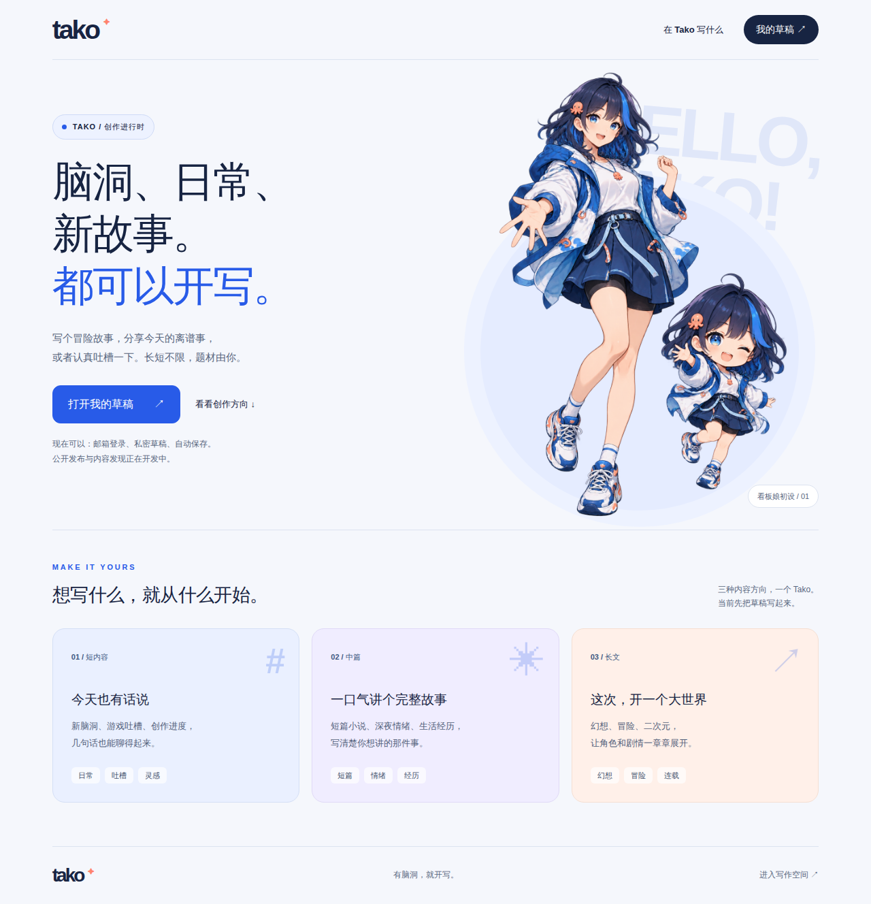
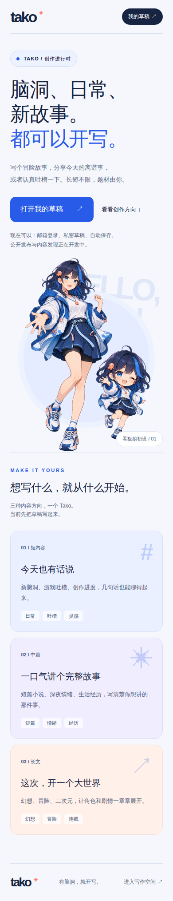

  

<h1 align="center">Tako</h1>

<strong>有脑洞，就开写。</strong>

冒险故事、深夜吐槽、今天的新鲜事。长短不限，题材由你。

Tako 正在成为一个年轻、多元的文字创作社区。短内容分享日常与灵感，中篇讲完一个故事或一段经历，长篇让角色和世界继续生长。看板娘是品牌形象，创作题材由作者自己决定。

> 当前界面的匿名浏览器截图。三类内容卡片展示产品方向，公开发布与内容发现仍在开发，没有虚构作品或运营数据。

看看手机布局

 

浏览器响应式截图；真实 iPhone 写作验收另见验收记录。

## 现在能做什么

先把自己的文字写下来，再放心地回来继续。

- 邮箱验证码登录，创建笔名和私密纯文本草稿。
- 自动保存，数据库确认后显示“已保存”；关闭重开后继续写。
- 服务断连时本机暂存；电脑和手机发生冲突时另存副本，保留双方文字。
- 原账号重新登录恢复待同步内容，支持导出和历史恢复。

**增量 A 核心链路已验收，当前是私有 ECS 测试环境，暂无公开体验地址。** 真机粘贴和 Wi-Fi／蜂窝切换仍是明确的验收尾项，待稳定 HTTPS 入口补测；不能将服务断链演练当作网络切换测试。

“已保存”表示数据库已提交。每日离机备份另行运行，正常恢复点约落后一天；本机缓存也不能抵抗浏览器数据被清除。

## 接下来一起把社区做出来

| 阶段 | 用户可以获得什么 | 当前状态 |
|---|---|---|
| A · 保存文字 | 登录、私密草稿、续写与冲突恢复 | 核心链路通过，两项真机补测待完成 |
| B · 公开作品 | 完整中篇发布、稳定链接阅读、隐藏与恢复 | B1/B2 本机验收通过；B3 治理闭环待交付 |
| C · 接收反馈 | 收藏、读过、评论、通知、举报与处置 | 待开发 |

正式首发还需补齐既定的内容发现、版本展示、治理及短内容／长篇基础能力。当前只有私有环境中的 B1/B2 发布阅读与版本管理，尚未公开运营，没有推荐、支付或规模运营成果。

## 从这里了解 Tako

- [增量 A 业务复盘](docs/reviews/2026-10-30-a-business-review.md)：为什么做、踩过什么坑、证据是否足够、还欠什么。
- [B2 版本管理与验收](docs/reviews/2026-10-30-b2-review.md)
- [B1 开发与验证记录](docs/reviews/2026-10-30-b1-review.md) · [B 业务规格](增量B开发规格.html)
- [验收证据与边界](docs/reviews/2026-10-30-a-acceptance.md) · [当前进度](docs/reviews/current-progress.md)
- [业务共识](项目业务共识.html) · [增量 A 开发规格](增量A开发规格.html)
- [看板娘与视觉方向](docs/brand-mascot-v1.md)

Go／Gin + MySQL + Nuxt／Vue／TypeScript，从模块化单体起步。当前不宣称高可用或高并发性能。

开发者入口：[启动与测试](docs/development-guide.md) · [API / Swagger](docs/api.md) · [运行与恢复](docs/operations.md) · [ECS 部署](docs/ecs-test-deployment.md) · [真机验收](docs/mobile-acceptance.md)。凭据、正文、备份与开发证书不进入仓库。
